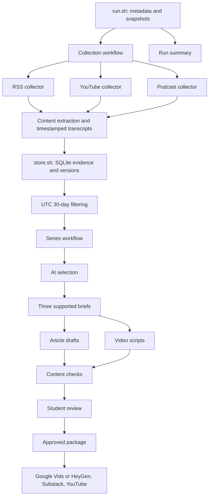

# Problem Set 4 Student Submission

**Student:** Mingjiao Diao  
**GitHub repository:** https://github.com/diaomj668/1.125ps04

## Topic and Audience

- **Publication name:** Small Project, Real Software
- **Topic:** Recent AI coding assistant capabilities and practices for individual developers completing small software projects.
- **Audience and assumed knowledge:** Individual developers with basic programming, terminal, and Git skills who build small web apps, scripts, or data tools.
- **Central question:** Which recent AI coding assistant capabilities and practices can help individual developers complete small software projects?
- **Scope and exclusions:** Implementation, performance diagnosis, testing, review, and verification. Exclude enterprise deployment infrastructure, model training, and unsupported product rankings.
- **Reason for readers to return:** Follow recent capabilities and practical evidence, and reconsider earlier judgments as evidence changes.

## Published Series

The final series uses the approved October 14 drafts, with an evidence as-of date of 2026-10-14. The October 15 run supplies repeatability and update evidence. Articles are free; videos are Unlisted. The student confirmed access to all six publications without login; see the [access record](runs/20261014T225746Z-d041cf/package/access_verification.json). Matching article/video URLs are present in both directions, but YouTube external-link clickability requires account verification.

| Piece | Title | Substack article | YouTube video |
| --- | --- | --- | --- |
| 1 | New ways to supervise, inspect, and constrain coding agents | [Read article](https://mingjiao.substack.com/p/new-ways-to-supervise-inspect-and) | [Watch video](https://youtu.be/pDt5vDDNF7E) |
| 2 | A successful signal is not necessarily successful software | [Read article](https://mingjiao.substack.com/p/a-successful-signal-is-not-necessarily) | [Watch video](https://youtu.be/8lIFBSltIm0) |
| 3 | Make the next agent task bounded, inspectable, and affordable | [Read article](https://mingjiao.substack.com/p/make-the-next-agent-task-bounded) | [Watch video](https://youtu.be/xV7t_A6FAcw) |

**Separate technical demonstration video:** To complete: add the recorded 4–6 minute demonstration link.

## Setup and Execution

Local execution used Bash and Python 3.12. Python package versions are pinned in [requirements.lock.txt](requirements.lock.txt); the extraction components use yt-dlp and FFmpeg for media processing. See the [operating guide](docs/OPERATING_GUIDE.md) for component interfaces and replay commands.

```bash
python3 -m venv .venv
.venv/bin/pip install -r requirements.lock.txt
# For a new checkout only; do not overwrite an existing .env.
cp .env.example .env
# Set credentials and provider settings in .env before execution.
bash run.sh
bash run.sh --package runs/20261014T225746Z-d041cf
```

Credential variable: `OPENAI_API_KEY`. Model setting: `PIPELINE_MODEL=gpt-6.1-sol`, with medium reasoning effort in the project configuration. Optional provider variables are `OPENAI_BASE_URL`, `PIPELINE_INPUT_USD_PER_MILLION`, and `PIPELINE_OUTPUT_USD_PER_MILLION`. Do not include secret values in the submission. Transcription uses `whisper-1` when native timestamped captions are unavailable; video narration used `tts-1` with the `alloy` voice.

Configure the topic and model in [config/project.json](config/project.json), RSS/YouTube/podcast sources in [config/sources.json](config/sources.json), selection rules in [config/editorial_policy.md](config/editorial_policy.md), and model instructions in [prompts/](prompts/). Each live run retains configuration and prompt snapshots. Packaging requires a human approval matching the current content-review fingerprint.

## Architecture and Manual Handoffs



All sixteen required Bash entry points retain their responsibilities. Focused Python helpers implement individual components; `run.sh` and the two workflows coordinate them. Model calls occur in selection, briefing, article writing, script writing, and transcription when needed. Only `data/store.sh` and its owning helper access the persistent evidence index; evidence text and transcripts are retained separately.

The automated pipeline produces articles, video scripts, references, and content checks. Human source judgments are recorded in [human_review.md](runs/20261014T225746Z-d041cf/human_review.md); final publication approval is recorded in [approval.json](runs/20261014T225746Z-d041cf/approval.json). The [package manifest](runs/20261014T225746Z-d041cf/package/manifest.json) lists the three approved articles, three scripts, and three source notes passed to production and publishing.

Video production used the approved scripts for synthesized narration and text-card visuals, followed by Google Vids editing and MP4 export. [Production records](runs/20261014T225746Z-d041cf/video_production/google_vids/README.md) retain editor/export links and limitations. The three MP4s were uploaded to YouTube. Approved article copies and source notes were formatted in Substack and published with free access. [Substack records](runs/20261014T225746Z-d041cf/publishing/substack/publication.json) and [publication links](runs/20261014T225746Z-d041cf/package/publication_links.json) document the resulting publications and cross-links.

## Evidence and Runs

- **Persistent evidence index:** `data/evidence/index.sqlite`; inspect through `bash data/store.sh list` or `bash data/store.sh stats`.
- **Retained source text and timestamped transcripts:** [data/assets/](data/assets/). Item/version records identify the corresponding files.
- **Original media:** `data/media/` is excluded from Git. Retrieve omitted media from each retained item's `url` or `media_url`; the [operating guide](docs/OPERATING_GUIDE.md) describes media retrieval.
- **Editorial trace:** [decisions](runs/20261014T225746Z-d041cf/decisions.jsonl), [briefs](runs/20261014T225746Z-d041cf/briefs.jsonl), [articles](runs/20261014T225746Z-d041cf/articles/), [scripts](runs/20261014T225746Z-d041cf/video_scripts/), and [content checks](runs/20261014T225746Z-d041cf/review.json).
- **Source independence, incentives, and missing perspectives:** [source notes](docs/SOURCE_NOTES.md).

| Run | Actual UTC date | Run artifacts and logs | Elapsed time | Approximate cost |
| --- | --- | --- | --- | --- |
| First live run, including recovery | 2026-10-14 | [Run](runs/20261014T225746Z-d041cf/run.json), [summary](runs/20261014T225746Z-d041cf/summary.json), [logs](runs/20261014T225746Z-d041cf/logs/), [attempts](runs/20261014T225746Z-d041cf/attempts/) | About 1,186 summed active stage-seconds; includes retries and differs from wall-clock duration | Main-run estimate $1.9788; policy selection rerun $1.5116 separately; audio, failed calls, and narration are not fully priced |
| Second live run, followed by editorial repair | 2026-10-15 | [Run](runs/20261015T194925Z-8e319e/run.json), [summary](runs/20261015T194925Z-8e319e/summary.json), [logs](runs/20261015T194925Z-8e319e/logs/), [repair](runs/20261015T194925Z-8e319e/editorial_revision/README.md) | Original execution about 463.6 seconds; subsequent repair recorded separately | Model estimate $2.1453; repair used no new paid calls; not a complete invoiced total |

[Two-run comparison](docs/run-comparison.md) records five new items, six changed version IDs, and thirty unchanged items. Changed hashes alone do not prove meaningful new developments. Newly collected YouTube material contributed to the October 15 repaired drafts; those drafts were retained for demonstration, while the October 14 series remained the final publication.

Date-window decisions are retained in each run's `eligible.jsonl` and `exclusions.jsonl`, using its actual UTC execution date and the preceding 30 days. Both runs recorded seven date-window exclusions. The first run's [recovery record](runs/20261014T225746Z-d041cf/recovery_status.json) and attempt logs preserve API-credit and YouTube discovery failures and recovery; unresolved extraction failures remain documented. The second run's repair record preserves the original failed coverage check and corrected outputs.

[Duplicate replay](runs/replay-20261016T040737Z-8cfe40/README.md) and [verification](runs/replay-20261016T040737Z-8cfe40/verification.json) demonstrate repeated processing of three unchanged real records in an isolated store. After initial ingestion, two repeats each returned three `unchanged` results; item/version counts stayed at three and the formal store was unchanged. This offline replay was executed on October 16 UTC and is separate from the two live runs.

**Published claim trace:** Article 3's claim `03-c4` recommends trying bounded tasks with periodic inspection, based on attributed practitioner experience rather than a controlled productivity result. Follow its [brief](runs/20261014T225746Z-d041cf/briefs.jsonl) and accepted [decision](runs/20261014T225746Z-d041cf/decisions.jsonl) to item `podcast:acc83661b4084b701efe6573`, version `d30ec05b567a9c16691e94f84c0c309050357ceea62781c3afa91b62697aed23`. The [timestamped transcript](data/assets/22a4727bb752021261e5/d30ec05b567a9c16691e94f84c0c309050357ceea62781c3afa91b62697aed23/segments.json) includes short tasks at 4:40, check-ins at 5:02, and usage concerns at 7:33 and 7:41. See the [original episode](https://www.htmlallthethings.com/podcast/ais-biggest-problem-isnt-intelligence-anymore).

## Editorial Review

The [completed source-review worksheet](runs/20261014T225746Z-d041cf/human_review.md) compares AI reasons with student judgments for three accepted and three rejected/deferred items, with supporting passages and corrections. The [saved prompts](runs/20261014T225746Z-d041cf/prompts/) and policy snapshots preserve the instructions used.

The policy revision distinguishes access restrictions, setup requirements, and practical relevance: Teams/Enterprise labels alone do not establish irrelevance to an individual developer. Compare the [original policy](runs/20261014T225746Z-d041cf/policy_revision/before/editorial_policy.md) with the [revised policy](runs/20261014T225746Z-d041cf/policy_revision/after/config/editorial_policy.md), [rerun decisions](runs/20261014T225746Z-d041cf/policy_revision/after/decisions.jsonl), and [comparison with student interpretation](runs/20261014T225746Z-d041cf/policy_revision/comparison.md). Four decision labels changed on the same 33 evidence versions; model variation remains a limitation.

The [editorial revision record](runs/20261014T225746Z-d041cf/editorial_revision/README.md) preserves initial drafts and applied corrections, including describing profiling as diagnosis rather than demonstrated repair or speed improvement. The final articles contain 854, 859, and 847 words excluding references. Limitations include vendor incentives, anecdotal experience, uncertain individual access/cost, and the absence of controlled evidence for improved project completion. Final student approval and the matching review fingerprint are retained in [approval.json](runs/20261014T225746Z-d041cf/approval.json) and [review.json](runs/20261014T225746Z-d041cf/review.json).

## Reflection

The system highlighted the importance of inspecting actual outputs rather than treating an agent’s success message as proof of completion. One editorial limitation was rejecting a feature partly because of its Teams/Enterprise label; the revised policy separated access restrictions from practical relevance. My next improvement would be to verify individual access and usage costs before recommending a tool. Architecturally, caching unchanged media transcripts reduced repeat-run time and API costs, but could miss edits made without metadata changes. This tradeoff fits a small project with limited resources, although periodic revalidation would improve reliability.
