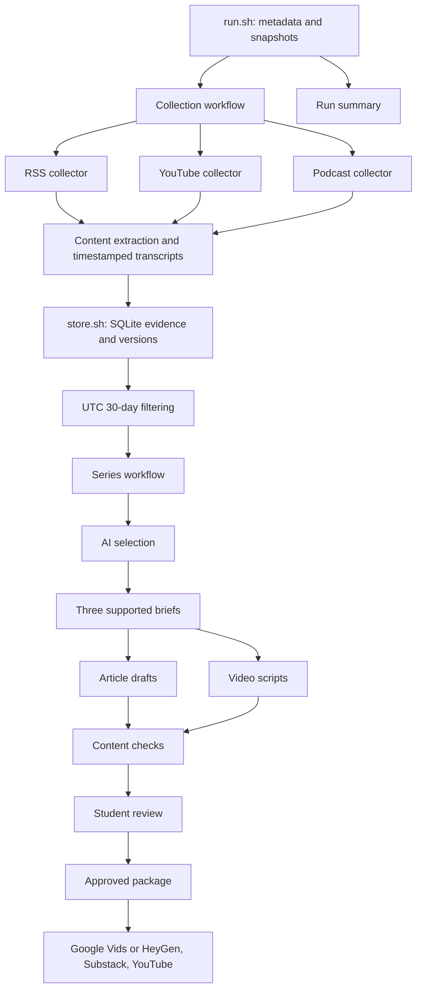

# Problem Set 4 Student Submission

**Status:** Three article drafts, three video scripts, and references generated in one clean live run; automatic content checks passed. Awaiting final student review of revised drafts. Two inaccessible source candidates remain logged as partial collection failures. Three accompanying videos are uploaded to YouTube as unlisted at the student request. Substack publication and final editorial approval records remain pending.

**Student:** To be supplied by the student  
**GitHub repository:** Submission repository URL pending

## Topic and Audience

- **Publication name:** Small Project, Real Software
- **Topic:** Recent AI coding assistant capabilities and practices for individual developers completing small software projects.
- **Audience and assumed knowledge:** Individual developers with basic programming and terminal/Git skills who independently build small web apps, scripts, or data tools; includes hobbyists and students.
- **Central question:** Which recent AI coding assistant capabilities and practices help individual developers complete small software projects, including debugging and verification?
- **Scope and exclusions:** Requirements, implementation, debugging, testing, review, and verified delivery costs. Exclude enterprise deployment, model training, and unsupported product rankings.
- **Reason for readers to return:** Follow new capabilities and practical evidence while checking whether earlier judgments still hold.
- **Voice and language:** English, clear, evidence-led, and explicit about uncertainty.

## Published Series

Drafts and word counts are linked in [progress](docs/PROGRESS.md). YouTube videos are uploaded as unlisted; Substack articles and cross-links remain pending.

| Piece | Editorial purpose | Substack article | YouTube video |
| --- | --- | --- | --- |
| 01 | [New ways to supervise, inspect, and constrain coding agents](runs/20261014T225746Z-d041cf/articles/01.md) | Not published | [YouTube (unlisted)](https://youtu.be/pDt5vDDNF7E) |
| 02 | [A successful signal is not necessarily successful software](runs/20261014T225746Z-d041cf/articles/02.md) | Not published | [YouTube (unlisted)](https://youtu.be/8lIFBSltIm0) |
| 03 | [Make the next agent task bounded, inspectable, and affordable](runs/20261014T225746Z-d041cf/articles/03.md) | Not published | [YouTube (unlisted)](https://youtu.be/xV7t_A6FAcw) |

**Separate technical demonstration video:** Not recorded. See [outline](docs/TECHNICAL_DEMO_OUTLINE.md).

## Setup and Execution

Python 3.12 and Bash were used locally. Install dependencies and configure credentials locally:

```bash
python3 -m venv .venv
.venv/bin/pip install -r requirements.lock.txt
# Create .env from .env.example only if .env does not already exist.
bash run.sh
bash run.sh --package runs/RUN_ID
```

Required variables: OPENAI_API_KEY and PIPELINE_MODEL. Never submit secret values. The selected main model is gpt-6.1-sol with medium reasoning effort. Audio transcription uses whisper-1 when supported native timestamped captions are unavailable. Actual tools, models, times, usage, estimated costs, and unknown costs are retained per run.

Topic settings, source definitions, editorial policy and prompts are in their prescribed config/ and prompts/ files and snapshotted for each run. See the [operating guide](docs/OPERATING_GUIDE.md).

## Architecture and Manual Handoffs



All sixteen required Bash entry points are implemented. Each owning component has its own focused helper; no shared application owns the whole pipeline. The collection workflow uses a real Unix pipe. Only data/store.sh and its owning data/store.py access data/evidence/index.sqlite directly.

The automated run reaches drafts, scripts, references and checks. Only the student can supply approval.json matching current reviewed inputs. Packaging independently rechecks the fingerprint and preserves entered publication links.

Three accompanying videos have been produced using Google Vids and uploaded to YouTube as Unlisted. Remaining work: final evidence, synthesis, caption, and audiovisual review; matching editorial approval and packaging; three 600–900 word free-access Substack publications; article/video cross-links; logged-out access checks; the separate technical demonstration; the second live run and comparison; and the final reflection and submission repository. Preparing a package is not publication.

## Evidence and Runs

- Canonical evidence index: data/evidence/index.sqlite.
- Retained text and timestamped transcripts: data/assets/.
- Original downloaded media: data/media/; excluded from Git. Retrieve using each saved item's url or media_url and document any omitted media.
- Actual run directories and draft links: [progress](docs/PROGRESS.md).
- Independence, incentives, and missing perspectives: [source notes](docs/SOURCE_NOTES.md).

| Run | Actual UTC date | Artifacts | Elapsed time and estimated cost |
| --- | --- | --- | --- |
| Clean live run with same-day recovery | 2026-10-14 | [Summary](runs/20261014T225746Z-d041cf/summary.json), [review](runs/20261014T225746Z-d041cf/review.json), [recovery](runs/20261014T225746Z-d041cf/recovery_status.json) | Initial and recovery receipts retained; estimated model tokens $1.9788, plus unpriced audio/failed calls |
| Second-day live run | Pending; user will run tomorrow | Not yet created | Not yet measured |

Previous generated attempts and fictional replay outputs were deleted before this clean restart. They are not part of the submitted evidence. Preserve this run and tomorrow's run for actual comparison. No second-day behavior is claimed before execution.

## Editorial Review

The six-item student source-review sample is complete. Inspect the [review worksheet](runs/20261014T225746Z-d041cf/human_review.md) and its linked actual evidence. Personally compare at least three accepted and three rejected/deferred decisions, record corrections, revise the policy, and preserve before/after outputs. The original policy remains preserved; the implemented student-requested clarification and actual selection comparison are linked below. Student interpretation is complete; revised-draft approval is pending. Mechanical checks cannot establish source independence, semantic support, or sound interpretation.

## Reflection

To be completed by the student using the run's actual findings and personal review. Discuss one insight, one editorial limitation, one next improvement, and one architectural tradeoff.

An implemented tradeoff is media caching: unchanged native IDs, titles and publication metadata permit transcript reuse, reducing cost but potentially missing edits in place. Written content is fetched again and versioned by substantive content rather than retrieval time.

## Student Policy Revision Update

The student supplied judgments for three accepted and three rejected/deferred sources. The access/setup/relevance policy clarification was implemented, with before/after versions and a real selection rerun on identical saved evidence. [Actual comparison](runs/20261014T225746Z-d041cf/policy_revision/comparison.md) records four changed decisions and model-variation limits. The student completed the comparison interpretation and authorized incorporating narrow Cursor coverage. Initial drafts are preserved in editorial_revision/before/. Current revised drafts pass content checks; final approval, Substack publication, and the second live collection remain pending.

## Revised Draft Handoff

[Revision record](runs/20261014T225746Z-d041cf/editorial_revision/README.md) preserves the initial artifacts, exact changes, and actual edit time. Current article word counts are 854, 859, and 847; narration word counts are 468, 496, and 520. References and claim manifests match the revised briefs. Final student approval has not been supplied.

## Current Video Review Drafts

Three actual Google Vids MP4 exports are available for student review. [Editors, exports, production method, and limitations](runs/20261014T225746Z-d041cf/video_production/google_vids/README.md) are recorded separately from the failed HeyGen attempts. Full caption and audiovisual review, final editorial approval, Substack publication, cross-links, and logged-out access checks remain pending. Actual YouTube unlisted links are recorded in the Published Series table above.
